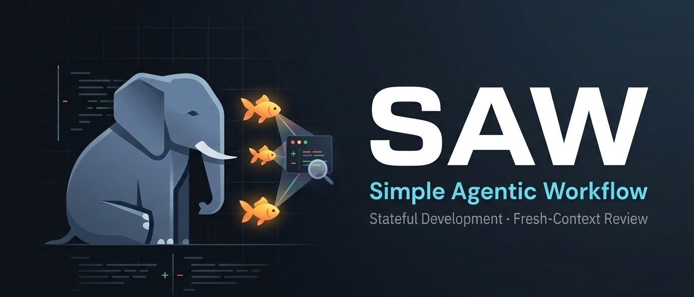
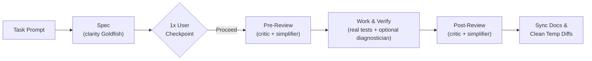

<p align="center">
  
</p>

<p align="center">
  A lightweight, <code>.envrc</code>-style workflow for <strong>stateful development</strong> and <strong>fresh-context review</strong>—without heavy ceremony.
</p>

<p align="center">
  <a href="LICENSE"></a>
  <a href="#quick-start-60-seconds"></a>
  <a href="probes/RUNBOOK.md#harness-scorecard"></a>
  <a href="probes/RUNBOOK.md#harness-scorecard"></a>
</p>

---

## Why SAW?

- **Elephant (Stateful Development)**: Holds conversation context, drafts specs, writes code, and runs real verification commands.
- **Goldfish (Fresh-Context Review)**: Read-only subagents spawned with zero chat history to inspect only isolated inputs (`spec`, `diff`, `seed`, or `symptom+repro`)—catching blind spots without sycophancy.
- **Anti-Slop & Minimal Diff**: Prevents bloated "AI grenade" PRs with bounded specs, dual-lens review (`critic` + `simplifier`), and read-only diff triage.

## How `/saw-run` Works



*(Trivial 1-line fixes fast-path directly without Goldfish. Deep dive: [Architecture & Isolation](docs/architecture.md).)*

---

## Quick Start (60 Seconds)

**Prerequisites**: `bash`, `git` (plus authenticated `gh` CLI for GitHub PR triage in `/saw-diff-commit`).

```sh
git clone https://github.com/jheo4/simple-agentic-workflow.git
cd simple-agentic-workflow

# Install all 3 harness adapters (or --targets copilot,claude,antigravity)
./install.sh /path/to/your-project

# Later updates (preserves .saw/profile.md, custom packs/lenses, and custom skills;
# refreshes built-in SAW files and prunes retired SAW skills)
./install.sh /path/to/your-project --update
```

Open `/path/to/your-project` in your coding agent:
- **Antigravity** *(App, CLI, or VS Code extension)*: Start a new conversation / reload window (or run `/skills reload` in `agy` CLI), then run `/saw-setup`.
- **GitHub Copilot** *(VS Code extension)*: Select the **`saw-elephant`** agent in Chat, then run `/saw-setup`.
- **Claude Code** *(CLI or VS Code extension)*: Run `/saw-setup` directly *(adapter included; Layer 2 scorecard pending in [`probes/RUNBOOK.md`](probes/RUNBOOK.md))*.

Then run **`/saw-run <task>`** for end-to-end execution, or **`/saw-help`** anytime to view phases and active Goldfish lenses.

---

## Commands & Examples

### Start / Auto
| Skill | When to Use |
|---|---|
| `/saw-setup` | Populate or refresh `.saw/profile.md` (stack, docs, verification commands). |
| `/saw-run [pack] <task>` | Full auto flow: spec → 1 checkpoint → pre-review, work, tests, post-review, sync. |
| `/saw-help [goal\|pack]` | Show workflow map, active Goldfish lenses per phase, or get a command pick. |

### Manual Lifecycle
| Skill | Phase & Lenses |
|---|---|
| `/saw-brainstorm [pack] <topic>` | `brainstorm` (`incremental`, `reframe`, `zoom`, `reality`) — pick the right task. |
| `/saw-spec [pack] <task>` | `spec` (`clarity`) — draft scope, edge cases, and verification criteria. |
| `/saw-review [pack] [spec\|diff\|focus]` | `review` (`critic`, `simplifier`) — refine a spec or pending changes. |
| `/saw-work [pack] <spec\|task>` | `work` (`diagnostician` on demand + `review`) — implement, test, and review. |
| `/saw-sync` | `sync` — pinpoint-sync `.saw/profile.md` and docs to current code on disk. |

### Read-Only Diffs (No Checkout, No Edits)
| Skill | Example & Purpose |
|---|---|
| `/saw-diff-commit [pack] <target>` | `/saw-diff-commit #123`, `HEAD~1..HEAD`, `feat-x` — defuse AI grenade PRs/commits (`review` phase). |
| `/saw-diff-files [pack] <left> <right> [focus]` | `/saw-diff-files v1/ v2/`, `a.json b.yaml` — compare code, data, or docs (`diff` phase: `concept`, `direction`, `detail`). |

---

## Installed Layout & Verification

<details>
<summary>Installed files inside <code>&lt;your-project&gt;/</code> (click to expand)</summary>

```text
<your-project>/
├── .saw/               # Core protocol, profile, packs, lenses, gitignored work/
├── .github/            # Copilot: copilot-instructions.md, skills/, saw-elephant/goldfish agents
├── .claude/            # Claude Code skills/ and read-only saw-goldfish agents
├── .agents/            # Antigravity skills/ and .agents/plugins/saw/
├── CLAUDE.md           # Claude Code SAW instructions block
├── AGENTS.md           # Antigravity SAW instructions block
└── .gitignore          # Appends .saw/work/
```

</details>

- **Customization**: Extend `general` via `.saw/packs/<name>.md` instead of editing built-in files—see [Customizing Packs & Lenses](docs/customization.md).
- **Layer 1 (Static & Installer)**: `./verify.sh` validates `install.sh`, YAML-safe skill frontmatter, `general.md` lenses, multi-target installs, `--update` preservation/pruning, and self-install.
- **Layer 2 (Canary Probes)**: `./probes/prepare-sandbox.sh` + [`probes/RUNBOOK.md`](probes/RUNBOOK.md) (`P1`–`P6`).

---

## License

[MIT](LICENSE)
