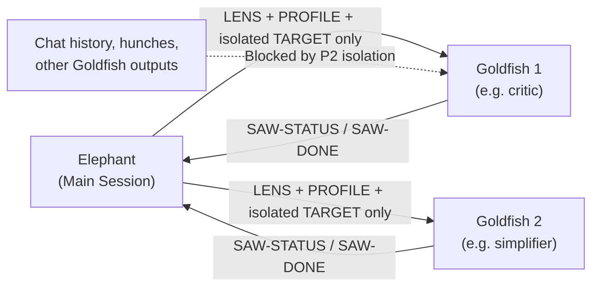
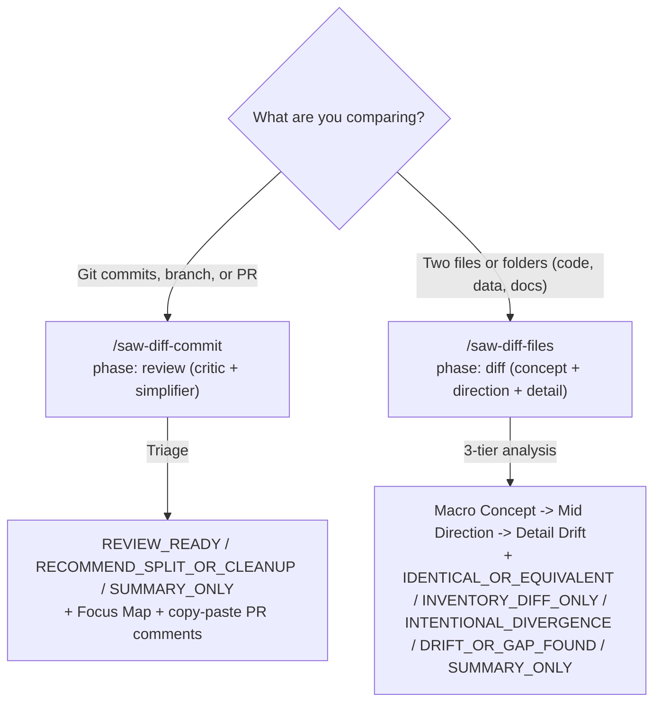

# SAW Architecture & Design

> Back to [README](../README.md) · Related: [Customizing Packs & Lenses](customization.md) · Core spec: [`templates/protocol.md`](../templates/protocol.md)

Simple Agentic Workflow (SAW) separates **stateful execution** from **fresh-context evaluation** so coding agents produce small, verified, human-reviewable changes instead of bloated "AI grenades." Unlike single-thread prompts (which validate their own assumptions) or multi-gate spec frameworks (which bury you in approval reports), SAW pairs **deterministic verification** (`.saw/profile.md` commands) with **cognitive fresh-context audits** (Goldfish) inside a bounded execution loop with at most one spec checkpoint (`/saw-run`).

- **Daily entrypoints**: `/saw-setup` (configure `.saw/profile.md`), `/saw-run` (automated end-to-end flow), or `/saw-help` (guide).
- **Manual lifecycle**: `/saw-brainstorm` → `/saw-spec` → `/saw-review` → `/saw-work` → `/saw-sync`.
- **Read-only diffs**: `/saw-diff-commit` (Git/PR triage) and `/saw-diff-files` (arbitrary file/dir comparison).

---

## 1. Elephant–Goldfish Isolation Model

- **Elephant (Main Session)**: Holds conversation context, inspects the repo, writes specs and code, executes real verification commands from `.saw/profile.md`, and talks to the user.
- **Goldfish (Read-Only Subagents)**: Spawned fresh for each lens with **zero prior conversation history**. Goldfish cannot edit files or run mutations.

Per Rule **P2** in [`templates/protocol.md`](../templates/protocol.md) (installed to `.saw/protocol.md`), Elephant passes **only**:
- **`LENS`**: The read-only stance prompt (`.saw/lenses/<lens>.md` and/or the pack row's inline `focus`), ending in `SAW-DONE` (for `brainstorm`/`diff`/`diagnostician`) or `SAW-STATUS: OK|SUGGEST` (for `spec`/`review`).
- **`PROFILE`**: Project summary, doc pointers, and verification commands (`.saw/profile.md`).
- **`TARGET`**: Only the phase artifact — `SEED` (brainstorm prompt), `SPEC` (task spec), `DIFF_PATH` (diff packaged into `.saw/work/...` by Elephant because Goldfish has no shell), `SYMPTOM + REPRO` (failing test/logs for blind bug diagnosis), or `LEFT/RIGHT` (packaged file/dir comparison); post-work review in `/saw-work` and `/saw-run` also gets SPEC as reference.

Hiding chat history and hunches prevents confirmation bias where an agent validates its own assumptions.

---

## 2. Two Diff Tools, Two Questions

SAW separates git-history/PR review from general artifact comparison because they answer fundamentally different questions:

- **`/saw-diff-commit`**: Evaluates changes *without checking out* (`git diff`, `git show`, or `gh pr diff`) to shield reviewers from unverified, multi-concern AI PRs. Requires a git repo (plus `base-branch` in `.saw/profile.md` for single-branch targets, and an authenticated `gh` CLI for `#<id>` / PR URLs).
- **`/saw-diff-files`**: Packages unified diffs for shared text paths plus bounded excerpts for unshared, cross-format, or reorganized files (requiring a `.saw/` workspace) so `concept`, `direction`, and `detail` lenses can compare structure as well as lines.

---

## 3. Core Guardrails & Loop Policy

1. **Human-Reviewable Minimal Diff**: Keep edits scoped to the task—no drive-by refactors, import shuffling, or cryptic diff-golfing.
2. **Verify Against Reality**: Never report checks as passing unless real commands from `.saw/profile.md` ran after the final edit; spec items no command can test pass only on evidence cited after the final edit, otherwise they are marked manual.
3. **Fast-Path Trivial Edits**: Typos, comments, and 1-line config tweaks skip Goldfish and run verification directly.
4. **Bounded Loops (`rounds`)**: Default caps in `.saw/packs/general.md` (see [Customizing Packs & Lenses](customization.md)) are `spec=1` (clarity checks), `review_pre=1` (spec review), `work_fix=3` (verify-fix retries), `review_post=2` (post-work diff review), and `review_manual=2` (standalone `/saw-review` rounds):
   - In `/saw-run` (auto mode), Elephant applies valid fixes or records 1-line skip reasons, advancing automatically when `spec`, `review_pre`, or `review_post` reaches its cap—but **halts early** if verification commands or Verification Criteria items still fail after `work_fix` retries.
   - In manual skills (`/saw-spec`, `/saw-review`, `/saw-work`), Elephant asks whether to run another round or wrap up if open suggestions remain at the cap.
5. **Never Commit Unasked**: `git commit` and `git push` run only on explicit user request.
